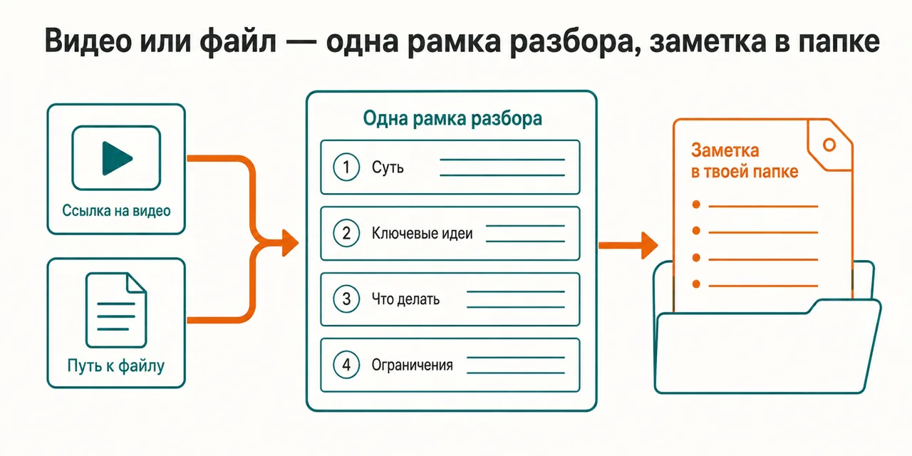
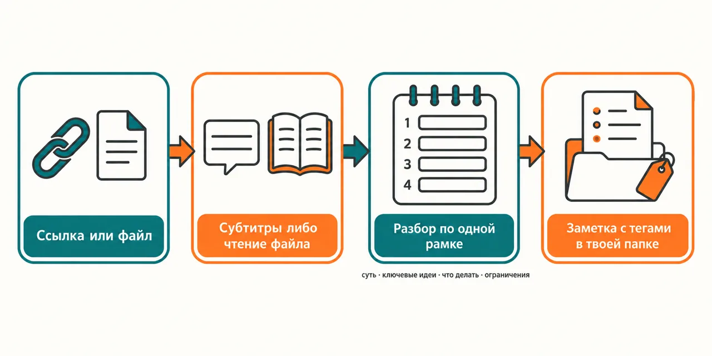

[Русский](README.md) · English

# You watched it or read it, and a week later not a line of it is left — with nowhere to go back to

The captions of a video or the text of a file go through one and the same frame — the gist, the key
ideas, what to do, the limits — and land as a separate note in your folder, not in a chat thread.

```
claude plugin marketplace add https://gitlab.com/beCyborg/jadlis-hub.git
claude plugin install jadlis-tldr@jadlis
```

No keys and no subscriptions: captions are pulled by a public route, and the plugin installs its own
dependency.



In words: on the left two inputs — a YouTube link and a file path — in the middle the shared analysis
frame, on the right the finished note in the folder you named at install time.

This is my workbench published as it is, not a product: whatever I stopped using, I removed.

## Before → after

| By hand | With an AI chat | With this plugin |
|---|---|---|
| **How the text of a video is obtained.** You scrub and listen yourself, taking notes as you go. | Not every chat accepts the link, and the one that does often retells the title and the description. | A script pulls the captions by a public route; manual ones come before auto-generated, lines are merged into paragraphs by pauses, `[Music]` and `[Applause]` are stripped out. |
| **What comes out at the end.** The notes follow the order of the material: the intro first, then everything in a row. | A short retelling arrives, and no single action follows from it. | The analysis runs on a fixed frame: the gist, the key ideas, what to do, the limits; every takeaway is written as an action plus the reason it works. |
| **Where the analysis settles.** The notes live in a notebook or never get written — there is nowhere to search later. | The analysis stays in the thread and leaves with it. | The note is written as a separate markdown file into the `TLDR_SAVE_DIR` folder — you can point it inside an Obsidian vault. |
| **How you find the note later.** The file is named whatever it named itself: "video", "lecture", "review". | There is nothing to find — no file was saved. | The file name is built from the main topic of the material, tags go into the frontmatter, the source link and metadata into the body; if a name collides, a suffixed note is placed alongside. |
| **When there is nothing to analyse.** You realise it halfway through watching. | It answers from the title of the clip as if it had watched it. | No captions — it says so plainly and stops; the request blocked by IP — it shows what exactly happened and offers a retry or a VPN. |

## How it works



Going in — a YouTube link or a file path, with the note language as an optional second word.
Inside — a separate script pulls the captions, a file is read whole, and both paths then converge
into one analysis frame.
Coming out — the note in your folder and its absolute path in the reply.

In words: link or file → captions or file read → analysis by the frame "gist, key ideas, what to do,
limits" → a tagged markdown note in `TLDR_SAVE_DIR`.

Installing the dependency is the plugin's own job: a `SessionStart` hook unrolls an isolated venv in
its data folder and diffs `requirements.txt` against a cached copy — if they match, the hook exits
silently, so the install happens once rather than every session. One package lives in that venv,
`youtube-transcript-api`. `yt-dlp` is not put there: it is an external binary, and the fallback onto
it switches on only if it is already present on the system.

Fitting the analysis to the size comes next: a short text is reduced to the gist and the list of
actions, and on a long video the skill warns up front that nuances may be lost. From YouTube it
understands four link shapes — `watch?v=`, `youtu.be`, `shorts`, `live` — and drops the playlist
tail. Files are taken by extension: `.md`, `.txt`, `.html`, `.pdf`, `.org`, `.rtf`, `.csv`, `.json`,
`.xml`.

## Installing and the first run

**a) Text to paste to an agent.** Copy the whole thing into a Claude Code chat:

```
You are the installer. Install the plugin jadlis-tldr from the jadlis marketplace on this Mac.
This plugin needs no keys, so ask me for nothing secret.
First ask me which folder the summaries should go into and put it in place of ~/tldr in the
second command — it may point inside an Obsidian vault.
Then run exactly these commands, verbatim, shortening nothing:
1. claude plugin marketplace add https://gitlab.com/beCyborg/jadlis-hub.git
2. claude plugin install jadlis-tldr@jadlis --config TLDR_SAVE_DIR=~/tldr
3. claude plugin list — show me the line about jadlis-tldr and its version.
After that tell me in one line: restart Claude Code — the dependency is unrolled by a hook
when the session starts.
Before each command show it to me in full and wait for "yes". If I say "no", do not run it,
tell me what you skipped, and move on.
If a command returns an error, stop, show me the output, and do not move to the next one.
```

**b) Commands by hand.**

```
claude plugin marketplace add https://gitlab.com/beCyborg/jadlis-hub.git
claude plugin install jadlis-tldr@jadlis
claude plugin list
```

The first command installs nothing — it adds the marketplace. Only the second one installs, and one
line removes it: `claude plugin uninstall jadlis-tldr@jadlis --keep-data`.

The notes folder is set by `TLDR_SAVE_DIR`, and it is passed straight into the install — `claude
plugin install jadlis-tldr@jadlis --config TLDR_SAVE_DIR=~/Notes/tldr`. Leave it unset and the notes go to
`~/tldr`. Changing the folder later goes through `/plugin` → jadlis-tldr → settings: on an already
installed plugin the `--config` flag silently changes nothing (checked 2026-09-07), so the other
route is a reinstall.

**c) The short command.** Open Claude Code in the folder you work in and type:

```
/jadlis-tldr:tldr https://www.youtube.com/watch?v=VIDEO_ID
/jadlis-tldr:tldr ~/Downloads/article.pdf en
```

If it is not found, check the name with `claude plugin list`. The second argument is the note
language: without it Russian, `en` gives English. Make the first run after restarting Claude Code —
the hook installs the dependency when a session starts.

## Limits, cost, updating

**What it does not do.** It does not listen to audio and does not transcribe speech: no captions
means nothing to analyse, and the skill says so and stops. It does not download the video and does
not hand back a verbatim transcript — only the analysis comes out. It does not go to other video
platforms: it understands YouTube links and nothing else. It does not read scans — from a PDF it
takes the text layer. It does not check the author: what the material says is what lands in the
note, and only the weak spots of the reasoning are flagged separately. It does not edit a note it
already saved — on a name collision it puts a new one alongside.

**What you need.** No keys are needed and no third-party subscriptions either: captions are pulled
by a public route. You need `python3` on the system — the hook uses it to unroll the venv and put
`youtube-transcript-api` in there. `yt-dlp` is optional, it is not in `requirements.txt` and the
plugin does not install it: install it yourself and you get a spare route for when YouTube blocks
the request by IP. The notes folder is `TLDR_SAVE_DIR`, and without it `~/tldr`.

[уточнить] — the repository pins no minimum version of `python3`.

**How tokens get spent.** A run is light: there are no subagents and no fan-outs here, and in one
pass the text goes through the model once. Long material costs more than the rest — the captions go
into context whole, and on a long recording the skill warns about it itself.

**Verified where I work:** my Mac, my subscription. Where else this works — [уточнить].

**Terms of use.** There is no license: all rights reserved by the author. You may read it and use it
personally. Commercial use, republishing and bundling it into your own products — by arrangement
with me.

**Updating.** With a third-party marketplace, auto-update is off on your side: until you run the
first command you keep the version you installed.

```
claude plugin marketplace update jadlis
claude plugin update jadlis-tldr@jadlis
claude plugin list
```

Reinstall, if something ended up crooked:

```
claude plugin uninstall jadlis-tldr@jadlis --keep-data && claude plugin install jadlis-tldr@jadlis
```
